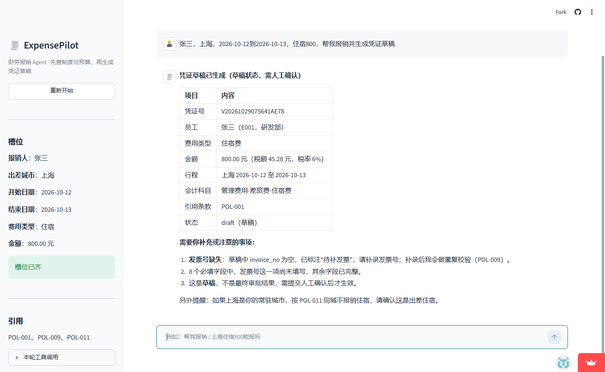
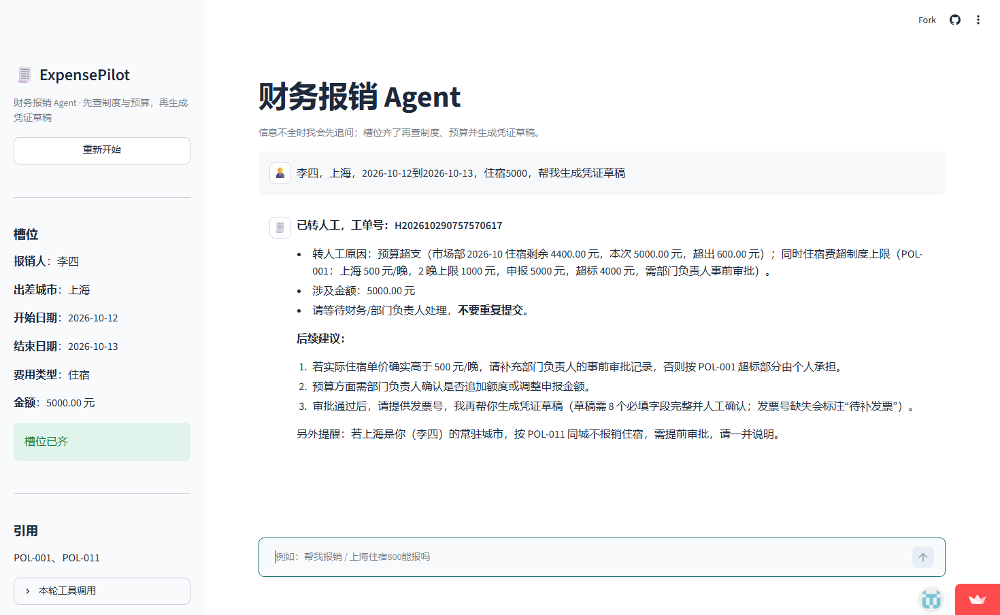

# ExpensePilot · 财务报销 Agent

[Live Demo](https://expensepilot-brtprbnrauirgule8zeg8y.streamlit.app) · [Gitee 仓库](https://gitee.com/ouyangzhi66/expensepilot) · [GitHub](https://github.com/ouyangzhi66/expensepilot) · [Issues](https://gitee.com/ouyangzhi66/expensepilot/issues) · [评测报告](docs/eval.md) · [开发日志](docs/log.md)

> 员工一句话描述出差 / 招待费用，Agent 查制度、算额度、验发票、生成凭证草稿；超规则自动转人工。

[部署说明](docs/deploy.md) · [3 分钟演示脚本](docs/demo-script.md) · [评测报告](docs/eval.md) · [开发日志](docs/log.md)

## 为什么不是又一个 RAG 聊天框

报销是一个多步任务：查制度 → 查额度 → 校验发票 → 生成凭证 → 人工确认。单轮 RAG 只能回答“住宿上限多少”，不能完成任务。这个项目要证明的是：

- 多工具编排（5 个工具：制度检索 / 预算 / 发票 / 凭证 / 转人工）
- 多轮槽位填充与追问
- 条件分支与人在回路（超限 / 越权转人工）
- 可评测（15 条端到端场景，指标见下；30 条为加固目标）
- 可观测（审计日志 / trace）

## 架构

```text
员工
  │
  ▼
Streamlit UI ──► LangGraph ──► policy_search ──► Postgres + pgvector
                    │
                    ├──► budget_check ──► Postgres
                    ├──► invoice_check ──► Postgres
                    ├──► voucher_create ──► Postgres
                    └──► escalate_to_human ──► 工单 / 审计日志
```

## 线上效果

正常单：一句话补齐槽位 → 查制度 → 查预算 → 生成凭证草稿（8 个字段，标注「待补发票」）。



异常单：超预算 / 超制度上限 → 不出凭证，直接转人工并给出工单号与依据条款。



> 以上截图来自 Streamlit Cloud 线上实例（2026-10-29），数据为合成数据。

## 部署

线上演示：https://expensepilot-brtprbnrauirgule8zeg8y.streamlit.app

Streamlit Community Cloud 部署步骤见 [docs/deploy.md](docs/deploy.md)。

> 免费版会休眠：首次打开需点「Yes, get this app back up!」唤醒，约 30–60 秒；应用重启后首轮还要下载 embedding 模型（约 100MB），会更慢一些。

### 演示视频

3 分钟演示（正常单 → 超限转人工 → 评测与代码）。录制脚本见 [docs/demo-script.md](docs/demo-script.md)；视频链接：待补充。

> 最近一次线上复验：2026-10-29，正常单（生成凭证草稿）与异常单（转人工）两条主路径均跑通。

应用通过 `st.secrets` 读取 Supabase 连接串和 API key，`.env` 只用于本地。

## 快速开始

### 0. 克隆

```powershell
git clone https://gitee.com/ouyangzhi66/expensepilot.git
cd expensepilot
```

### 1. 安装 Python 3.11
安装时勾选 `Add python.exe to PATH`。

### 2. 装依赖

```powershell
python -m venv .venv
.\.venv\Scripts\Activate.ps1
pip install -r requirements.txt -r requirements-dev.txt
Copy-Item .env.example .env
```

### 3. 数据库（二选一）

- **A. Supabase（推荐，免 Docker）**：新建项目 → SQL Editor 执行 `create extension if not exists vector;` → 把 Session Pooler 连接串填到 `.env` 的 `DATABASE_URL`。
- **B. 本地 Docker**：`docker compose up -d db`。

验证连接：

```powershell
python scripts/db_check.py
```

看到 PostgreSQL 版本和 `pgvector: True` 即成功。

### 4. 初始化表和数据

在 Supabase SQL Editor 依次执行：

1. `db/schema.sql`
2. `db/seed.sql`（会清空这 4 张表，仅用于演示数据）

### 5. 自检

```powershell
.\scripts\check.ps1
```

### 6. 分支与远程

- 主分支：`master`（Gitee 默认）
- 远程：`origin` → `https://gitee.com/ouyangzhi66/expensepilot.git`

> Gitee 不跑 GitHub Actions。`.github/workflows/ci.yml` 只在以后镜像到 GitHub 时用；日常用 `scripts/check.ps1`，Gitee Go 可选，不影响交付。

## 制度 RAG（D02）

```powershell
# 1. 在 Supabase SQL Editor 执行 db/migrations/002_policy_chunks.sql
# 2. 把制度条款切分、向量化、入库
python scripts/ingest_policies.py
# 3. 检索
python scripts/search_policy.py "上海住宿 800 能报吗"
```

默认用本地 `BAAI/bge-small-zh-v1.5`（512 维，约 100MB），不用 API key。首次运行会下载模型；国内网络慢时先设 `$env:HF_ENDPOINT="https://hf-mirror.com"`。

## Agent（D03）

```powershell
python scripts/ask.py "上海住宿800能报吗"
```

Agent 先调用 `policy_search` 查条款，再基于条款回答；回答里真正引用的 `POL-xxx` 会记进 `citations`。

## 预算查询（D04）

```powershell
python scripts/ask.py "李四再报5000住宿呢"
```

Agent 会同时调用 `policy_search` 和 `budget_check`，把制度上限和部门余额分开回答。

## 凭证草稿（D05）

```powershell
python scripts/ask.py "帮张三生成一张上海住宿800元的凭证草稿，2026-10-12到2026-10-13，引用POL-001"
```

`voucher_create` 生成 8 个必填字段，并用 `schemas/voucher.schema.json` 校验；只返回 JSON 草稿，不写库，最终需人工确认。

## 多轮槽位（D06）

```powershell
python scripts/chat.py
```

信息不全时先追问；槽位齐了才查制度/预算/生成凭证。`ask.py` 适合单轮，`chat.py` 用于多轮。

## 网页界面（D07）

```powershell
streamlit run app.py
```

打开 http://localhost:8501 。左侧显示槽位、引用、本轮工具调用和凭证草稿，右侧聊天。

## 人在回路（D08）

先执行 `db/migrations/003_audit_and_approvals.sql`。

```powershell
python scripts/ask.py "李四，上海，2026-10-12到2026-10-13，住宿5000，帮我生成凭证草稿"
```

超预算/代报/低置信时调用 `escalate_to_human` 生成工单，不直接出凭证；每次工具调用写入 `audit_logs`。

## 端到端评测（D09）

```powershell
python scripts/eval_agent.py
```

15 条场景全部通过（15/15），结果见 [eval/results_d09.csv](eval/results_d09.csv)。

## 评测

| 指标 | 目标 | 当前 |
|---|---|---|
| 任务完成率 | ≥85% | 15/15（D09） |
| 凭证字段完整率 | ≥95% | 8/8（D05） |
| 超限 / 越权拦截率 | 100% | 6/6（D09） |
| RAG 引用命中率 | ≥90% | 7/7（D02）、15/15（D09 端到端） |
| P95 时延 | ≤3s | 21.3s（未达标，见下） |

> 时延说明：每轮先做一次意图 / 槽位解析 LLM 调用，再走 agent ↔ tools，15 条场景均耗时 0.8–21.3s（均值 11.9s）。后续优化方向：槽位解析改成规则优先 + 小模型兜底、工具并行、首 token 流式输出。

场景分布与用例见 [docs/eval.md](docs/eval.md)、[eval/cases.csv](eval/cases.csv)。

## 已知限制

- 公开演示没有鉴权和频控：任何人都能触发工单与审计写库，正式部署需要加口令与限流。
- 会话状态在进程内存里（`MemorySaver`），应用重启或多实例时多轮上下文会丢。
- 评测是 15 条自建合成用例（RAG 子集 7 条），没有人工双标，只能说明主路径可用，不代表线上准确率。
- P95 21.3s，没有流式输出；慢在每轮多一次意图解析的 LLM 调用。
- Streamlit 免费版会休眠，首次打开要唤醒，冷启动还要下载 embedding 模型。

## Roadmap

### MVP（10 天）

- [x] D01 数据表 / 合成数据 / 10 条评测集
- [x] D02 制度 RAG：切分、embedding、pgvector、引用
- [x] D03 LangGraph 骨架 + `policy_search`
- [x] D04 `budget_check` + seed SQL
- [x] D05 `voucher_create` + JSON Schema
- [x] D06 多轮槽位 + 缺信息追问
- [x] D07 Streamlit happy path
- [x] D08 人在回路 + 审计日志
- [x] D09 15 条评测 + top-3 修复
- [x] D10 部署 + README
- [ ] D10 3 分钟视频

### 后续加固（按优先级，不强制全做）

- [ ] P1 30 条评测 + 错误分类
- [ ] P1 Dockerfile / compose 一键起
- [ ] P1 1 页项目报告（`docs/report.md`）
- [ ] P2 MCP Server（把工具暴露给其他 Agent 客户端）
- [ ] P2 发票 OCR + 票面金额校验
- [ ] P3 Langfuse trace / 成本统计
- [ ] P3 Vue 3 前端

> P1 是通用加固，先做；P2/P3 视实际使用场景再定。

## 每日 Gitee 流程

1. 开工：把当天 issue 打开，写一句“今日目标”。
2. 开发：每 30-45 分钟 commit 一次，Conventional Commits。
3. 收工：更新 `docs/log.md`，关闭 issue，README 进度打勾。
4. 每天 push 到 `master`；每个里程碑打一个 tag，写 Release notes。

10 个 issue 的标题和正文见 [docs/issues.md](docs/issues.md)。

> 提交使用与 Gitee 账号绑定的邮箱（`1161655868@qq.com`），保证提交归属正确，见「设置 → 邮箱管理」。

## 仓库结构

```text
expensepilot/
├─ app.py                 # Streamlit 页面
├─ src/expensepilot/      # Agent 图 / 槽位 / 工具 / 审计
├─ db/                    # schema.sql / seed.sql / migrations
├─ schemas/               # voucher.schema.json
├─ eval/                  # 测试集与评测脚本
├─ docs/                  # 部署、演示脚本、日志、评测、ADR
├─ scripts/               # check.ps1 本地自检
├─ tests/                 # pytest
├─ runtime.txt            # Streamlit Cloud Python 版本
├─ packages.txt           # 系统依赖（libgomp1）
├─ .github/               # GitHub 镜像用 CI + issue 模板
└─ docker-compose.yml     # Postgres + pgvector（可选）
```

## 数据与隐私

- 仓库只含合成数据：姓名、发票号、金额均为虚构。
- 不提交真实姓名、手机号、身份证、银行卡、工资、真实发票、API key、数据库连接串。
- `.env` 已忽略；截图前把姓名、金额、key 打码。
- Supabase 本身可以存真实财务数据（配合 RLS、权限、备份），但本项目演示仍用合成数据，避免误传。

## License

MIT
