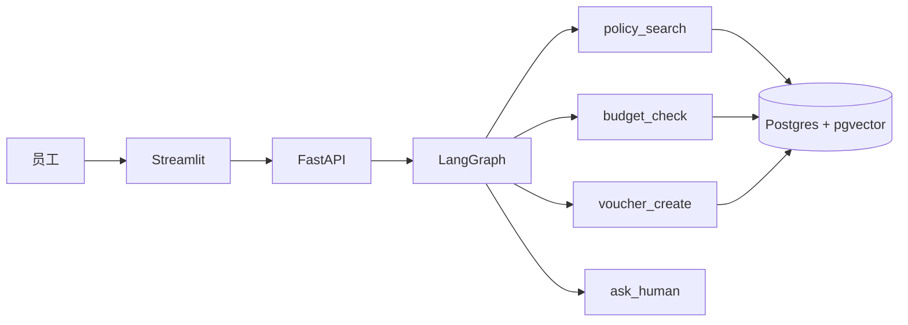

# ExpensePilot · 财务报销 Agent

[](https://github.com/YOUR_GITHUB/expensepilot/actions/workflows/ci.yml)


> 员工一句话描述出差 / 招待费用，Agent 查制度、算额度、验发票、生成凭证草稿；超规则自动转人工。

[Demo](TODO) · [3 分钟视频](TODO) · [评测报告](docs/eval.md) · [开发日志](docs/log.md)

## 为什么不是又一个 RAG 聊天框

报销是一个多步任务：查制度 → 查额度 → 校验发票 → 生成凭证 → 人工确认。单轮 RAG 只能回答“住宿上限多少”，不能完成任务。这个项目要证明的是：

- 多工具编排（7 个工具）
- 多轮槽位填充与追问
- 条件分支与人在回路（超限 / 越权转人工）
- 可评测（30 条场景 + 指标）
- 可观测（审计日志 / trace）

## 架构



## 快速开始

```powershell
python -m venv .venv
.\.venv\Scripts\Activate.ps1
pip install -r requirements.txt -r requirements-dev.txt
Copy-Item .env.example .env
docker compose up -d db
pytest -q
```

没有 Docker：用 Supabase 免费版（开启 pgvector），把 `.env` 里的 `DATABASE_URL` 换成连接串。

## 评测

| 指标 | 目标 | 当前 |
|---|---|---|
| 任务完成率 | ≥85% | TODO |
| 凭证字段完整率 | ≥95% | TODO |
| 超限 / 越权拦截率 | 100% | TODO |
| RAG 引用命中率 | ≥90% | TODO |
| P95 时延 | ≤3s | TODO |

场景分布与用例见 [docs/eval.md](docs/eval.md)、[eval/cases.csv](eval/cases.csv)。

## Roadmap

### MVP（10 天）

- [ ] D01 仓库 / 合成数据 / 10 条评测集
- [ ] D02 制度 RAG：切分、embedding、pgvector、引用
- [ ] D03 LangGraph 骨架 + `policy_search`
- [ ] D04 `budget_check` / `profile_get` + seed SQL
- [ ] D05 `voucher_create` + JSON Schema
- [ ] D06 多轮槽位 + 缺信息追问
- [ ] D07 Streamlit happy path
- [ ] D08 人在回路 + 审计日志
- [ ] D09 15 条评测 + top-3 修复
- [ ] D10 Docker / 部署 / README / 3 分钟视频

### 加固（D11-D21）

- [ ] 发票 OCR + 票面校验
- [ ] 30 条评测 + 错误分类
- [ ] Langfuse trace / 成本统计
- [ ] Vue 3 前端（可选）
- [ ] 1 页项目报告（GitHub Pages）

## 每日 GitHub 流程

1. 开工：把当天 issue 移到 Doing，写一句“今日目标”。
2. 开发：每 30-45 分钟 commit 一次，Conventional Commits。
3. 收工：更新 `docs/log.md`，关闭 issue，README 进度打勾。
4. 每周日：打 tag（`v0.1.0`），写 Release notes。

## 仓库结构

```text
expensepilot/
├─ src/expensepilot/      # Agent / tools / api
├─ eval/                  # 测试集与评测脚本
├─ docs/                  # 日志、评测、ADR
├─ tests/                 # pytest
├─ .github/               # CI + issue 模板
└─ docker-compose.yml     # Postgres + pgvector
```

## License

MIT
